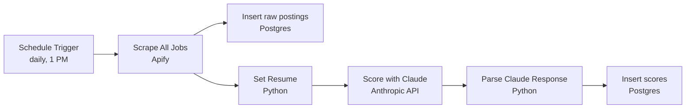

# Job Scoring Workflow (n8n + Claude)

An n8n workflow that scrapes new LinkedIn job postings in Germany every day, scores each one against my profile with Claude, and stores the results in Postgres.

It replaced about 2 hours of manual job searching per day.

## How it works



1. **Schedule Trigger** runs once a day at 1 PM.
2. **Scrape All Jobs** calls an Apify LinkedIn jobs actor. Filters: Germany, full time, posted in the last 24 hours, up to 100 results, agencies removed. It searches about 40 data and AI job titles and excludes internships, working student roles and senior leadership titles.
3. **Insert rows in a table** stores every raw posting in `raw_job_postings`, upserting on the job `id`.
4. **Set Resume** (Python) normalizes each posting, builds the scoring prompt, and attaches the candidate profile and scoring rules as the system prompt.
5. **Score with Claude** sends each posting to the Anthropic Messages API (`claude-haiku-4-5`), batched to stay within rate limits.
6. **Parse Claude Response** (Python) extracts the JSON fields from Claude's reply, including when the reply is wrapped in a code block.
7. **Insert rows in a table1** stores the result in `job_scores`.

## What each job gets scored on

Claude returns:

| Field | Description |
|---|---|
| `score` | Fit from 1 to 10 |
| `reason` | 2 to 3 sentences explaining the score |
| `matched_skills` | Skills from the JD the candidate has |
| `missing_skills` | Skills from the JD the candidate lacks |
| `experience_required` | Years stated in the JD, or "not specified" |
| `german_required` | `true` only if the JD states an explicit German level |
| `job_type_flag` | fulltime, parttime, internship, werkstudent or unclear |
| `apply_recommendation` | `true` or `false` |

Key scoring rules:
- Instant score of 1 if the JD states 5+ years minimum, the role is part time or student, or it's unrelated to data, AI or automation.
- German requirements never lower the score. They are captured separately in `german_required`, so I can filter on them myself.
- Transferable skills and equivalent tools count (for example dbt to Dataform, Snowflake to BigQuery).

## Setup

### 1. Import the workflow
In n8n: **Workflows → Import from File** → select `workflows/job-scoring-workflow.json`.

### 2. Add credentials
| Node | Credential type | Settings |
|---|---|---|
| Scrape All Jobs | Generic → Query Auth | Name `token`, value: your Apify API token |
| Score with Claude | Generic → Header Auth | Name `x-api-key`, value: your Anthropic API key |
| Both Postgres nodes | Postgres | Your database connection (I use Supabase) |

Also set the URL on **Scrape All Jobs** to:
```
https://api.apify.com/v2/acts/vIGxjRrHqDTPuE6M4/run-sync-get-dataset-items
```

### 3. Create the tables
Example schema. Adjust types to match your setup.

```sql
create table raw_job_postings (
  id                              bigint primary key,
  linkedin_id                     bigint not null,
  date_posted                     timestamptz,
  date_created                    timestamptz,
  title                           text,
  organization                    text,
  org_linkedin_industry           text,
  location                        text,
  employment_type                 text,
  date_valid_through              timestamptz,
  url                             text,
  seniority                       text,
  ai_key_skills                   text[],
  ai_hiring_manager_name          text,
  ai_hiring_manager_email_address text,
  ai_core_responsibilities        text,
  ai_requirements_summary         text,
  ai_job_language                 text,
  ai_visa_sponsorship             boolean,
  ai_keywords                     text[],
  description_text                text,
  scraped_at                      timestamptz default now()
);

create table job_scores (
  row_id               bigserial primary key,
  linkedin_id          bigint,
  score                integer,
  reason               text,
  matched_skills       text,
  missing_skills       text,
  experience_required  text,
  german_required      boolean,
  job_type_flag        text,
  apply_recommendation boolean,
  scored_at            timestamptz default now()
);
```

Join the two on `linkedin_id` to see each posting with its score.

### 4. Use your own profile
The candidate profile and scoring rules live in the `system_prompt` variable inside the **Set Resume - python code** node. Replace the profile with your own experience, skills and projects. Adjust the scoring rules to match what you care about.

Change the job titles, exclusions and location in the **Scrape All Jobs** request body to match your search.

## Tech stack

n8n · Apify · Python · Anthropic Claude API · PostgreSQL (Supabase) · Power BI for weekly review

## Notes

- Claude Haiku keeps cost low at around 100 postings per day.
- The workflow ships with `active: false`. Activate it in n8n after adding credentials.
- No API keys are stored in this repo. All secrets live in n8n credentials.
